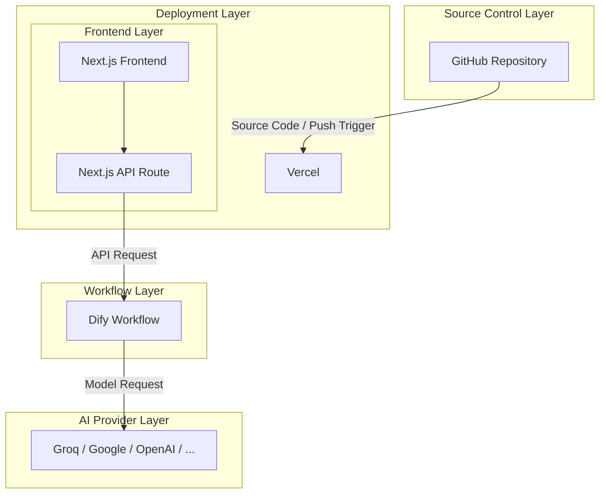

# Etymology Lookup

An English etymology lookup tool that analyzes word origins and structures using AI. It identifies prefixes, roots, suffixes, historical development, and related words.

## Features

- Analyze English word origins.
- Identify prefixes, roots, and suffixes.
- Display historical development of words.
- Find related words with etymological connections.
- Render structured Markdown output.
- Copy analysis results to the clipboard.

## Technology Stack

| Layer | Technology |
|---|---|
| Frontend | Next.js, React, TypeScript |
| Styling | CSS, SCSS |
| Markdown Rendering | React Markdown |
| Backend API | Next.js API Routes |
| AI Workflow | Dify |
| LLM Provider | Groq |
| Deployment | Vercel |
| Source Control | GitHub |

## Architecture



## Project Structure

```text
.
├── app/
│   ├── layout.tsx
│   ├── page.tsx
│   ├── api/
│   │   └── workflows/
│   │       └── run/
│   │           └── route.ts
│   ├── components/
│   │   ├── index.tsx
│   │   └── etymology-layout/
│   │       ├── etymology.tsx
│   │       ├── components/
│   │       │   ├── InputPanel.tsx
│   │       │   ├── OutputPanel.tsx
│   │       │   └── MarkdownOutput.tsx
│   │       ├── constants/
│   │       │   └── code.ts
│   │       └── utils/
│   │           ├── error.ts
│   │           └── validation.ts
│   └── styles/
│       ├── globals.css
│       ├── markdown.scss
│       └── etymology.css
├── public/
├── package.json
├── tsconfig.json
└── README.md
```

## Request Flow

1. The user enters an English word in the frontend.
2. The frontend validates the input.
3. The frontend sends the request to the Next.js API Route.
4. The API Route forwards the request to the Dify Workflow.
5. Dify processes the input using the Groq LLM.
6. The result is returned to the frontend.
7. React Markdown renders the analysis.
8. The user can copy the results.
