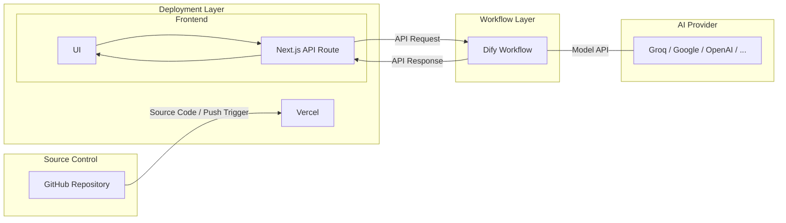
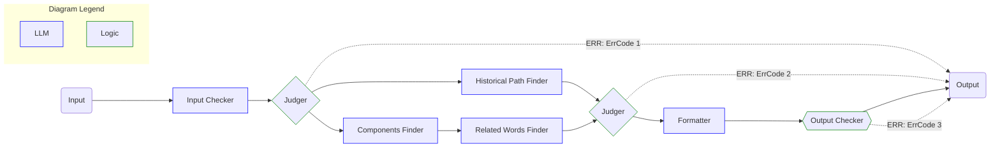

# Etymology Lookup

An English etymology lookup tool that analyzes word origins and structures using AI. It identifies prefixes, roots, suffixes, historical development, and related words.

## Features

- Analyze English word origins.
- Identify prefixes, roots, and suffixes.
- Display historical development of words.
- Find related words with etymological connections.
- Render structured Markdown output.
- Copy analysis results to the clipboard.

## Technology Stack

| Layer | Technology |
|---|---|
| Frontend | Next.js, React, TypeScript |
| Styling | CSS, SCSS |
| Markdown Rendering | React Markdown |
| Backend API | Next.js API Routes |
| AI Workflow | Dify |
| LLM Provider | Groq |
| Deployment | Vercel |
| Source Control | GitHub |

## Architecture



### Workflow Layer



## Project Structure

```text
.
├── app/
│   ├── layout.tsx
│   ├── page.tsx
│   ├── api/
│   │   └── workflows/
│   │       └── run/
│   │           └── route.ts
│   ├── components/
│   │   ├── index.tsx
│   │   └── etymology-layout/
│   │       ├── types/
│   │       │   └── etymology.ts
│   │       ├── etymology.tsx
│   │       ├── components/
│   │       │   ├── InputPanel.tsx
│   │       │   ├── OutputPanel.tsx
│   │       │   └── MarkdownOutput.tsx
│   │       ├── constants/
│   │       │   └── code.ts
│   │       └── utils/
│   │           ├── error.ts
│   │           └── validation.ts
│   └── styles/
│       ├── globals.css
│       ├── markdown.scss
│       └── etymology.css
├── package.json
├── tsconfig.json
└── README.md
```
